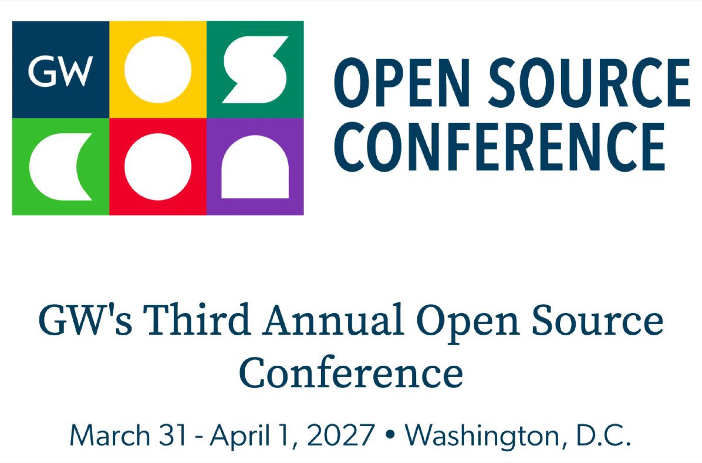
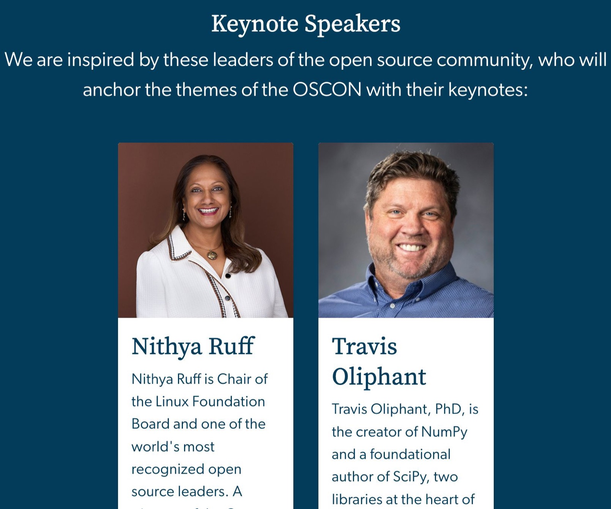
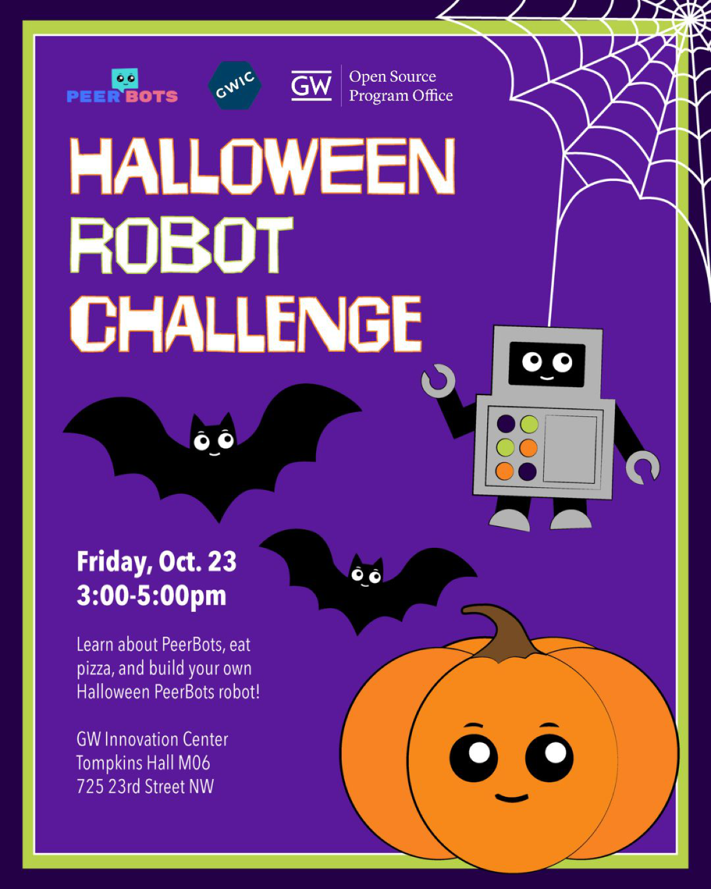
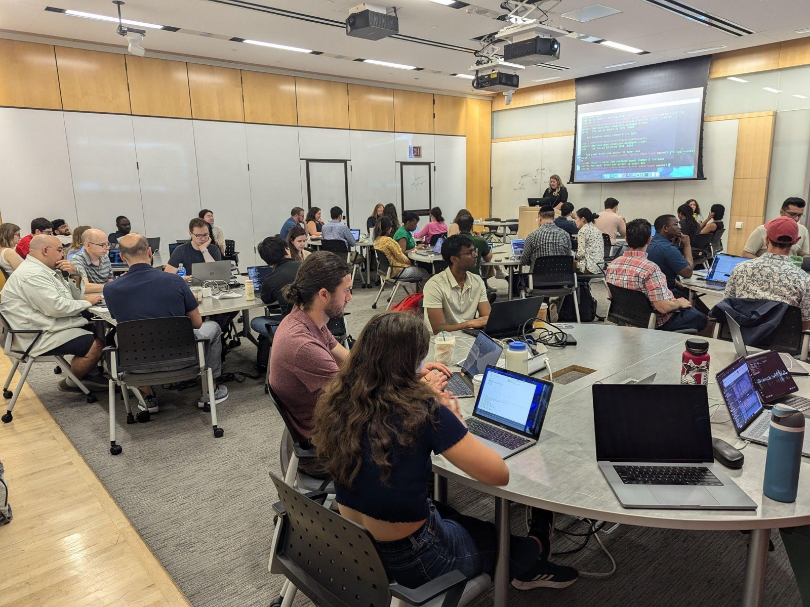
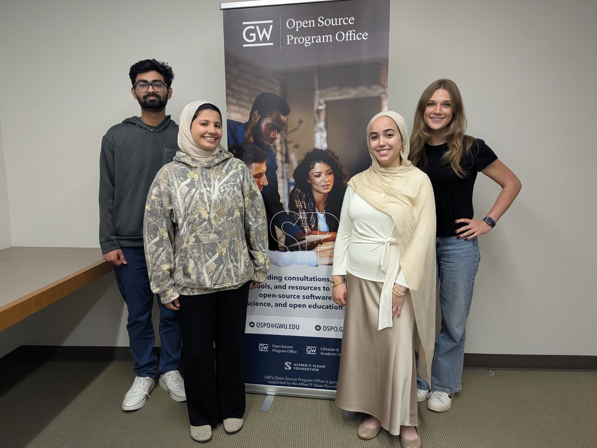
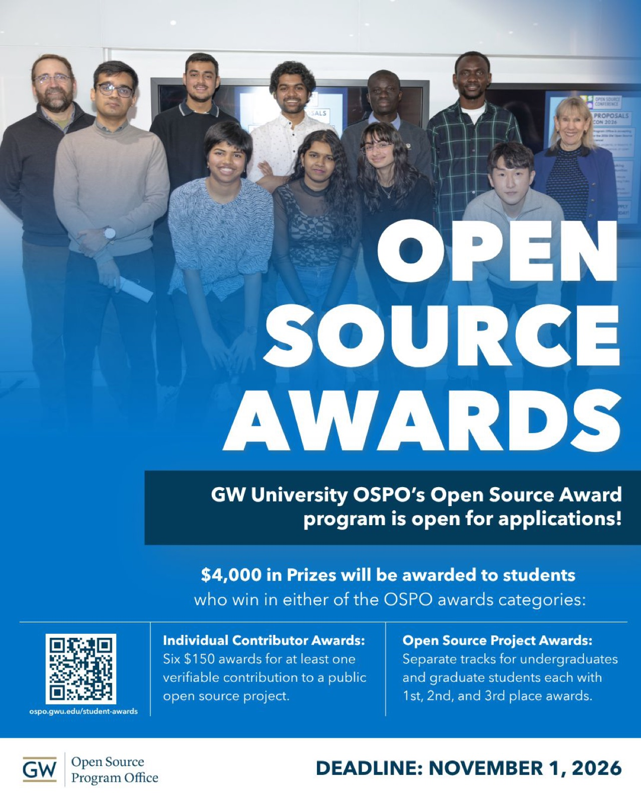
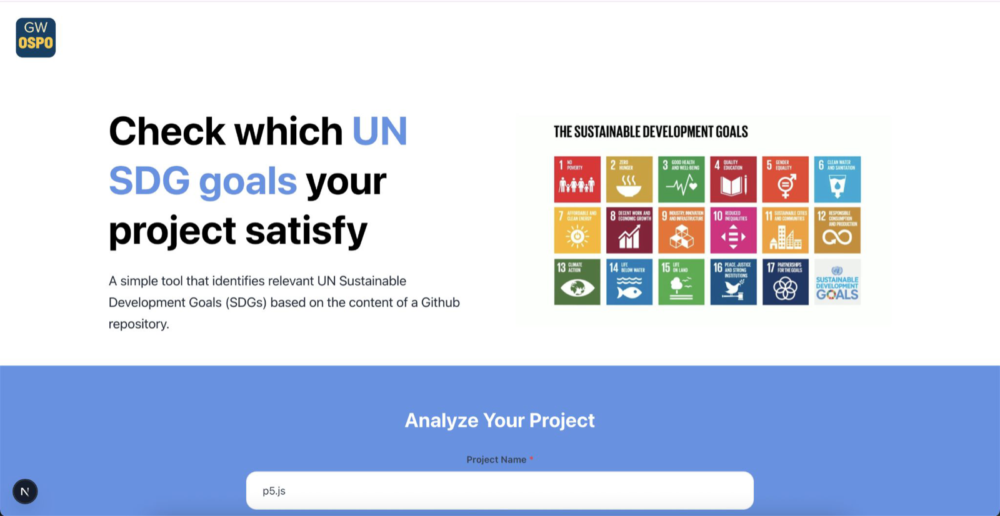
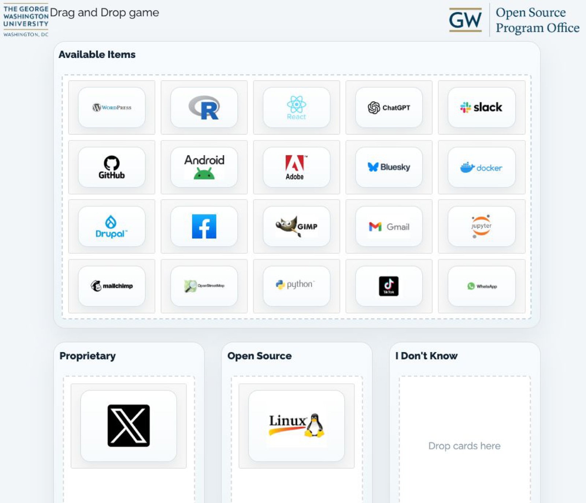
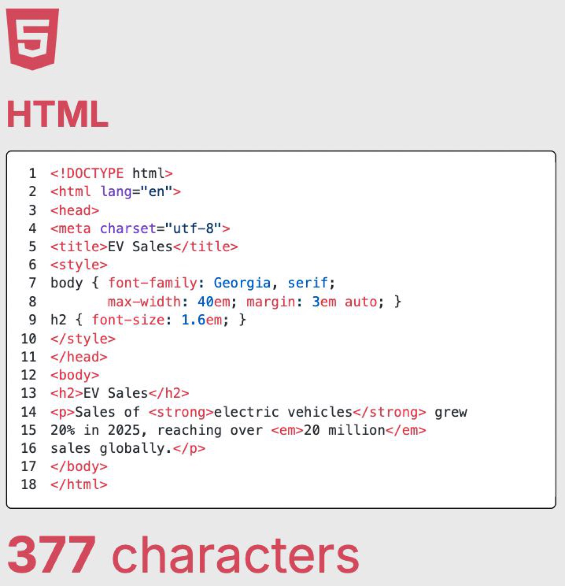
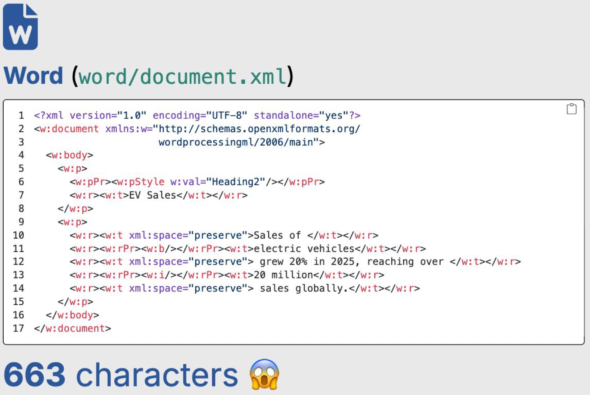







[Nava Open Source Summit]{.large}

# 

 

[]{.large}

---





# 01 OSPO Overview

---

[01. OSPO Overview]{.kicker}

# GW Open Source Program Office (OSPO)

:::: {.two-col}
::: {}
**Based in the Library:** Serving all GW students, faculty, staff, & researchers.

**Mission:** The OSPO fosters a culture of open collaboration by supporting researchers, educators, and students in using and developing open-source software, open data, and open access practices

**Website:** <https://ospo.gwu.edu/>

**Email:** <ospo@gwu.edu>
:::
::: {}
{fig-align="center" height="560"}
:::
::::

---

[01. OSPO Overview]{.kicker}

# GW OSPO Focus

:::: {.two-col .cards-up}
::: {.card}
### Education

- What is open source?
- How do I make research outputs public?
- Can open source help me get a job?
:::
::: {.card}
### Community Building

**Cross discipline GW connections**

**Local partners**

- Nava
- Civic Tech DC
- CMS

**Global partners**

- CURIOSS
- CHAOSS
- Open Forum for AI
- United Nations
:::
::::

---

[01. OSPO Overview]{.kicker}

# GW OSPO Events

:::: {.two-col .wide-left}
::: {}

::: {.small}
- GW OSCON - March 31-April 1 2027
- GW Coders Lunch & Learn - Wed 11:30am
- Hackathons
- Halloween Robot Challenge - Oct 23rd
- Academic Open Source Summit - Dec 2026
:::

::: {.img-row}

:::

:::
::: {}
::: {.poster-up}
{fig-align="center" height="580"}
:::
:::
::::

---

[01. OSPO Overview]{.kicker}

# GW OSPO Services

:::: {.two-col}
::: {.small}

- Consultations
- Workshops
- Grant Support

:::
::: {}
{fig-align="center" width="95%"}
[OSPO Research Workshop (Summer 2024)]{.caption}
:::
::::

---

[01. OSPO Overview]{.kicker}

# GW OSPO Initiatives

:::: {.two-col}
::: {.small}

- Student Ambassadors
- Student Awards Programs
- Open Source Project Registry
- GW Open Source Conference (OSCON)
- Stakeholder meetings
- Research Projects
- GW Open Source Projects
- Industry Partner Program
- OSPO Fellow Program
- OSPO Internships
- External Collaborations

:::
::: {}
{fig-align="center" width="95%"}
[2025/2026 GW OSPO Ambassadors]{.caption}
:::
::::

---





# 02 How are we using AI?

---

[02. How are we using AI?]{.kicker}

# AI design skills review process

::: {.compare}
::: {}

[Original]{.caption}
:::
::: {.middle-box}
**Design skill review process**

[github.com/gw-ospo/gwospo-design](https://github.com/gw-ospo/gwospo-design)

[→]{.arrow}
:::
::: {}

[Final]{.caption}
:::
:::

---

[02. How are we using AI?]{.kicker}

# AI impact to maintaining open source

:::: {.two-col}
::: {}

- AI Policy?
- How to trust new contributors?
- Losing track of the codebase
- Dividing the maintainer role into two positions - tech and architect
- Trying to run & deploy for free

:::
::: {}
{fig-align="center" width="95%"}
[UN Sustainable Development Goals (SDGs) Classifier]{.caption}
:::
::::

---

[02. How are we using AI?]{.kicker}

# AI Research

:::: {.two-col}
::: {.small}

**OSPO Research**

- OS literacy
- AI Skills
- NSF TRAILS

**Open Forum for AI**

- CMU, UT Austin, Georgia Tech, Purdue, GW
- Research, Technical prototypes, Policy recommendations, Community engagement, Talent for service

**Trustworthy AI**

- Openness

:::
::: {}
{fig-align="center" width="95%"}
[open source literacy game]{.caption}
:::
::::

---

[02. How are we using AI?]{.kicker}

# AI Research Cont. - Professor John P Helveston

:::: {.two-col}
::: {}

**AI & Quarto**

- Modularity
- Efficiency
- Correctness

:::
::: {.callout-box}
Quarto disentangles [Content]{.red} and [Format]{.blue}
:::
::::

::: {.formats}
::: {}
&nbsp;

:::
::: {}
[1.8x]{.mult}

:::
::: {}
[4x]{.mult}

:::
::: {}
[7.2x]{.mult}

:::
:::

---

[02. How are we using AI?]{.kicker}

# OSPO & Art & AI

:::: {.img-row .big}
::: {}

[digital art student stickers]{.caption}
:::
::: {}

[open source art show]{.caption}
:::
::::

---






# Thank you

**Website:** <https://ospo.gwu.edu/>

**Email:** <ospo@gwu.edu>

 

Special thanks to **Nava**
